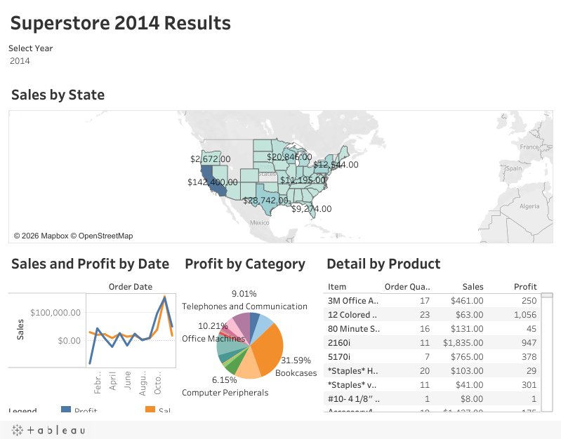

# Superstore Sales

Tableau analysis of a retail dataset covering sales, profit, discounts, shipping, and customer segments.

## Business question
Which categories, regions, and customer segments drive sales and profit, and where are discounts or shipping costs hurting margin?

## Data
- [`data/Superstore.csv`](data/Superstore.csv): about 9,400 orders with product, customer, region, sales, profit, discount, and shipping fields.
- Tableau's Superstore sample data (public).

## Files
- [`superstore-sales.twbx`](superstore-sales.twbx): packaged Tableau workbook (data included).

## Live dashboard
[View on Tableau Public](https://public.tableau.com/views/SuperstoreSalesAnalysis_17928899298350/Dashboard1)

The dashboard has a year filter that updates the sales map, sales and profit trend, profit-by-category breakdown, and product detail table.

## Key insights (2014)
- California led all states with about $142K in sales, far ahead of every other state.
- Bookcases contributed the largest share of profit (about 32%), followed by office machines and telephones.
- Sales and profit both peaked late in the year.
