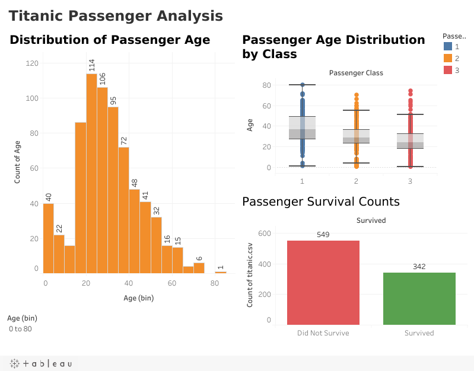

# Titanic Survival

Tableau exploration of Titanic passenger data using bar, column, line, histogram, and box plot views.

## Business question
How did age, sex, ticket class, and fare relate to survival?

## Data
- [`data/titanic.csv`](data/titanic.csv): 891 passengers with survival, class, sex, age, family, fare, and embarkation fields.
- Public Titanic dataset.

## Files
- [`titanic-survival.twbx`](titanic-survival.twbx): packaged Tableau workbook (data included).

## Live dashboard
[View on Tableau Public](https://public.tableau.com/views/TitanicSurvivalRates_17928899824600/Dashboard1)

## Key insights
- Only 342 of 891 passengers (about 38%) survived; 549 did not.
- Most passengers were young adults, with the largest age group in the 20–25 range.
- First-class passengers skewed older than second- and third-class passengers.
